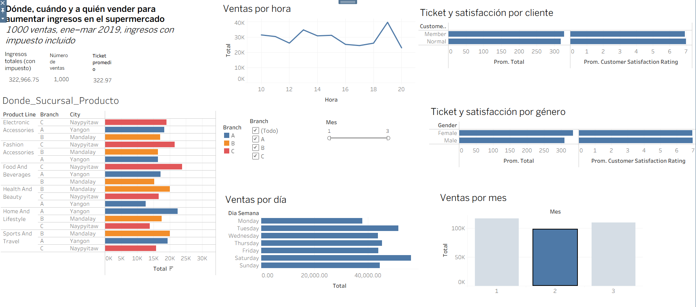

# Dónde, cuándo y a quién vender para aumentar ingresos en el supermercado

Análisis integral de `1,000` transacciones (enero–marzo de 2019) en tres sucursales del dataset público *Supermarket Sales* (`supermercado_limpio.csv`, con impuesto del 5% incluido y margen bruto constante).  
El proyecto integra limpieza y validación de datos, consultas SQL, análisis estadístico en Python y un tablero interactivo para respaldar decisiones comerciales.

## Pregunta de negocio
¿Dónde, cuándo y a quién conviene enfocar los esfuerzos comerciales del supermercado para aumentar los ingresos totales (`322,966.75` con ticket promedio de `322.97`)?

## Hallazgos principales
- **Dónde:** **Naypyitaw (C)** lidera los ingresos (`110,568.71`), y cada sucursal tiene una línea distinta de mayor ingreso: **Food And Beverages** en C (`23,766.86`), **Home And Lifestyle** en A (`22,417.20`) y **Sports And Travel** en B (`19,988.20`).
- **Cuándo:** El **sábado** es el día de mayor ingreso (`56,120.81`), la **hora 19** concentra el pico horario (`39,699.51`) y **enero** es el mes más fuerte (`116,291.87`, frente a `97,219.37` en febrero).
- **Quién:** Las diferencias en el ticket promedio entre tipo de cliente (**Member** vs. **Normal**, `p = 0.534`) y género (**Female** vs. **Male**, `p = 0.118`) no son estadísticamente concluyentes, y la satisfacción promedio se mantiene prácticamente igual (`6.94` a `7.01`); por ello, estos segmentos por sí solos no justifican campañas diferenciadas.

## Vista previa del dashboard

## Enlaces del proyecto
- **Dashboard interactivo (Tableau Public):** [Ver dashboard en Tableau Public](https://public.tableau.com/app/profile/jose.miguel.almonte.solis/viz/P4_17951180366960/Dashboard1)
- **Notebook de análisis (P5):** [Abrir notebook en Colab](https://colab.research.google.com/drive/10f6ivW8P5FGvOol6eptRktHjmuFflH2R?usp=sharing) · [Archivo en el repo](notebooks/P5_analisis.ipynb)
- **Resumen ejecutivo de una página (P6):** [Ver Resumen_P6.pdf](docs/Resumen_P6.pdf)
- **Consultas SQL (P3):** [Ver consultas.sql](sql/consultas.sql)
- **Datos limpios (P2):** [Ver supermercado.csv](data/supermercado.csv)

## Herramientas utilizadas
- **SQLite** (tabla `supermercado` y consultas de validación/agregación)
- **Python** (`pandas`, `seaborn`, `matplotlib`, `scipy`)
- **Tableau** (dashboard interactivo en una sola página con filtros globales)
